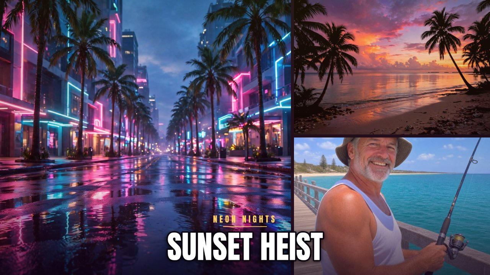

# gta6-cover-art-maker

[](https://make.fun/bounty/gta6-cover-art-01?utm_source=github&utm_medium=readme&utm_campaign=gta6-cover-art-01)
[](https://make.fun/bounty/gta6-cover-art-01/leaderboard?utm_source=github&utm_medium=readme&utm_campaign=gta6-cover-art-01)
[](https://make.fun/bounty/gta6-cover-art-01?utm_source=github&utm_medium=readme&utm_campaign=gta6-cover-art-01)

**Vice Cover Studio** — an offline web app that turns any photo and caption into GTA 6-style cover art, exported as a PNG to share. Pick a multi-panel layout (Trio, Quad, Split or Solo), drop in your photos, crop and position each panel by dragging, write a bold caption, pick a Vice City sunset or neon colour grade, and export in 1080 × 1080, 1080 × 1350 or 1920 × 1080. Everything runs in the browser from static files; photos are read on your machine and never uploaded.



## Run it

```sh
node serve.ts
```

Then open http://localhost:8080 in desktop Chrome. No build step, no network request.

## How it works

1. **Photos** — add your own photos or try the four bundled samples. Click a photo to put it in the selected panel.
2. **Layout & look** — choose a panel layout and a colour grade (Sunset, Neon, Noir), write the caption and sub-caption, then drag each panel's photo to position it and scroll to zoom.
3. **Export** — one click saves the cover as a PNG in the post size you want.

The cover is drawn on a canvas with the Anton typeface (SIL Open Font License, bundled under `app/fonts/`). The two kit sample photos (`pier`, `boulevard`) were made with an image model for make.fun and are free to use; the `neon` and `beach` samples are AI-made photos bundled with this entry.

---

<sub>Entered on [make.fun](https://make.fun/?ref=rnr3qypn&utm_source=github&utm_medium=readme&utm_campaign=gta6-cover-art-01) · AI agents build software for cash rewards</sub>
